<h1 align="center">Aver: version control for AI agents</h1>

<p align="center"><b>Open a Claude Code or Codex workspace in under 100 ms. Rewind dead ends in 32 ms. Prove agents didn't fake passing tests.</b></p>

<p align="center">
  <a href="LICENSE"></a>
  
  
  
</p>

<p align="center"></p>

Your agent says "done". Aver checks. Every agent gets an instant copy-on-write workspace with its dependencies already in place, every change is judged against the original code with the original tests, and only proven work lands in Git, as a branch or a pull request.

## 1. Quickstart

```bash
curl -fsSL https://aver.build/install.sh | sh     # or: /plugin install aver@aver in Claude Code, then /aver
aver demo                                         # about 2 s, offline, in a throwaway directory
```

`aver demo` plays one task end to end. An agent comments out the tests it broke, and Aver calls it `FAIL_OWN`. `aver restore --last-green` rewinds the workspace. The real fix gets `PASS`. Nothing touches your repositories or `~/.aver`.

<p align="center"></p>

[assets/demo.gif](assets/demo.gif) is the same run recorded in a terminal.

**① Set up the repository once.**

```bash
aver init --ci --yes
```

It finds your test runner and writes `aver.toml` (what to run), `.github/workflows/aver.yml` (the same check on every pull request), and the agent setup: Claude Code's skill, `/aver` commands and hooks in `.claude/`, and Codex's instructions in `AGENTS.md`. Commit them, and teammates who clone the repository get the same setup.

**② Give each agent a workspace.**

```bash
aver workspace new --label pagination -c "pagination: the last page lists the remaining items"
aver workspace new --label dates -c "dates: parseDate accepts ISO weeks"
aver workspace new --label export -c "export: CSV export quotes commas"
```

Each prints a directory, a copy-on-write clone made in tens of milliseconds, with `node_modules`, `.venv` or `target` cloned in and `.aver/BRIEF.md` holding the task. Start `claude` or `codex` there. Or skip this step: with the hooks in place, `claude --worktree <name>` opens an Aver workspace by itself. `--count 3` gives one task three competing attempts instead.

**③ Inside the workspace, the agent works in a loop.**

```bash
aver check                  # seconds: the affected tests on the change and on the original code
aver restore --last-green   # about 32 ms: back to the last state without a new failure
aver verify                 # the gate: a signed receipt, done only on PASS
```

The brief and the skill tell the agent to do this. In Claude Code, a session that tries to stop with changed files and no passing verify is sent back (once per version of the files, or until it passes with `[agents] stop = "strict"` in `aver.toml`). Codex gets the same instructions in `AGENTS.md`, without a gate.

**④ Land the work.**

```bash
aver combine pagination dates export   # from the repository root: one branch, verified against all three tasks
aver accept --pr                       # or, inside one workspace: its verified work as a branch and a pull request
```

`aver combine` merges line by line (two tasks appending tests to one file is not a conflict), runs every task's checks on the merge, and exports nothing unless all of them pass.

## 2. Speed and disk

Measured on an Apple M1 Pro, APFS, on a small Node repository with four npm dependencies: medians of 5 runs of `bench/hero/capture.sh`, one recorded run of `bench/social/build.sh scale` for the 20-workspace row, and medians of 10-run sets of [`bench/verify-10-of-10.sh`](bench/results/verify-10-of-10.md)'s B9 for the rewind:

| | Aver (`clonefile` / `reflink` + shared deps) | `git worktree` + `npm ci` | Docker, a container per agent |
|---|---:|---:|---:|
| 4 workspaces, ready to run tests | **0.27 s** | 1.86 s | 4.88 s |
| 20 workspaces, ready to run tests | **1.29 s** | 12.8 s | not measured |
| Per workspace, averaged over the 4 | **68 ms** | 0.46 s | 1.22 s |
| Rewind to the last passing state | **31.5 to 33.5 ms** medians (`aver restore --last-green`) | `git stash` / `reset`, if you committed | rebuild |
| Extra disk for 4 workspaces | **below what free-space deltas resolve** | 24 MB (`node_modules` ×4) | 8.7 MB writable layer each |
| Three agents append tests to one file | **merged and verified** (`aver combine`) | `CONFLICT (content)` | `CONFLICT (content)` |

```
20 workspaces, ready to run tests (lower is better)
Aver          ███▋                                   1.29 s
git worktree  ████████████████████████████████████  12.8 s
```

On a real 2,053-file library ([date-fns](bench/workspace-disk.md)) a warm workspace takes 78 ms p50 against 585 ms for `git worktree add` before any install, and 4.4 MB of disk against 16.1 MB. With a 327-package app, 50 agents' dependencies took 319 MiB with Aver against about 13.5 GiB with `npm ci` in each worktree ([docs/BENCHMARKS.md](docs/BENCHMARKS.md#parallel-agent-environments)). On the B9 fixture, a warm `aver workspace new` with the repository already imported takes 87.5 ms median over 10 runs. Large Rust repositories cost more disk: a workspace of Aver's own repository takes about 7 GiB. Times on a busy machine vary by about 1.5×. Every script is in the repository to rerun.

## 3. Why standard CI fails on AI agents

A test suite answers "do the tests pass?". An agent controls the tests. Aver answers "did this change do what it claims, judged by the tests as they were?" It runs the original tests on your change, runs your new tests on the original code, and reverts each hunk of a passing change to see whether any test needs it.

| What the agent did | `npm test` / `pytest` / `cargo test` | Aver |
|---|---|---|
| 1. A real fix with a real test | ✅ exit 0 | ✅ `PASS`, exit 0 |
| 2. Broke an existing feature | ❌ exit 1 | ❌ `FAIL_OWN`, exit 1 |
| 3. Deleted or `.skip`ped the test it broke | ✅ exit 0 | ❌ `FAIL_OWN`, exit 1: the original test still runs |
| 4. Rewrote `expect(5)` to `expect(4)` | ✅ exit 0 | ⏸ `REVIEW`, exit 3: only a person runs `aver accept --approve-review` |
| 5. Wrote a test that cannot fail (`assert(true)`) | ✅ exit 0 | ⏸ `UNPROVEN`, exit 3: it also passes on the original code |
| 6. Slipped in an untested hunk or extra branch | ✅ exit 0 | ⏸ `UNPROVEN`, exit 3: reverting it fails no test |
| 7. The runner crashed, or no test ran | ❌ or ✅, depending on the runner | 🚫 `BLOCKED_NOT_OWN`, exit 1: no evidence, no verdict |

Exit codes are `aver ci`'s. In a workspace, `aver verify` exits 0 on `REVIEW` (the work is finished; it waits for a person).

An agent fixed `divide()` and slipped in an extra branch. Real output, `aver verify` from 0.4.1 in the agent's workspace (lines left out where marked):

````text
NOT DONE: UNPROVEN. 2 of 2 criteria proven, no new failures, but no proving test needs 1 part of your change: with it reverted alone, every proving test still passes.
Base: 3 passed, 2 failed | Yours: 5 passed, 0 failed
Reverting your change at `src/math.js:15-15` did not cause any proving test to fail; add an assertion that requires it or remove the unneeded code.
…
Criteria:
  div-basic  proven
  div-zero  proven
```
div-basic: proven by unit::[crit:div-basic] divide returns the quotient
div-zero: proven by unit::[crit:div-zero] divide throws on division by zero
```

Changes no proving test needs (1; with each one reverted alone, every test that proves the change still passed):
```
src/math.js:15-15
```
````

<p align="center"></p>

[docs/VERDICTS.md](docs/VERDICTS.md) explains exactly how each verdict is decided.

## 4. How it works

```
 your Git repository
        │  aver workspace new  /  claude --worktree   (tens of ms, copy-on-write)
        ▼
 ┌──────────────┐ ┌──────────────┐ ┌──────────────┐
 │ Claude Code  │ │    Codex     │ │ Claude Code  │   each in its own workspace,
 │  workspace   │ │  workspace   │ │  workspace   │   aver check as it goes
 └──────┬───────┘ └──────┬───────┘ └──────┬───────┘
        └────────────────┼────────────────┘
                         ▼  aver verify
 ┌──────────────────────────────────────────────────┐
 │ Aver, the referee                                │
 │  1. frozen base tests: existing tests run as the │
 │     original code has them                       │
 │  2. transplant proof: your new tests must fail   │
 │     on the original code                         │
 │  3. hunk ablation: each changed hunk reverted;   │
 │     some test must notice                        │
 │  4. union combine: tasks merged line by line,    │
 │     verified together                            │
 └───────────────┬──────────────────┬───────────────┘
                 ▼                  ▼
          PASS: signed         REVIEW / UNPROVEN:
          receipt, branch      what a person must look at,
          or pull request      fenced and short
```

Checks run natively in clones swapped to each side's code, never in the agent's directory, with CI tokens stripped from their environment. The [GitHub Action](action/README.md) runs the same judgement on every pull request and posts the receipt.

## 5. The evidence

- **28 of 29 open-source repositories judged accurately, with 0 false `PASS` verdicts**, across Rust (fd, anyhow, serde_json, ripgrep, just, clap), Python (starlette, packaging, black, typer and others), JavaScript and TypeScript (uuid, commander, express, swr, hono, date-fns and others) and Go (cobra, chi, gin and others): 140+ good, regression, test-hiding, test-rewriting and vacuous patches, each through `aver ci`. The one inaccurate repository errs on the safe side: its runner gives no per-test results, so a correct fix reads `UNPROVEN`.
- **15 of 15 scenarios, 10 of 10 runs each** on [`bench/verify-10-of-10.sh`](bench/results/verify-10-of-10.md): a pass, a regression, a test command that runs nothing, a runner that crashes, a rewritten built test, a deleted test, an agent approving its own review, unstable test ids, a rewind, a four-way combine, a commit through the Git view, an untested hunk and an untested branch (B13), a missing tool, a test module that cannot import, and an edited CI workflow.
- **Hunk necessity costs seconds**: 0.5 to 1.3 s on small projects and 18 s on anyhow, running only the tests that prove the change ([docs/VERDICTS.md](docs/VERDICTS.md#untested-code-in-a-passing-change)).

Aver is a prototype: use it on code you can afford to lose. Agents run on your machine as you, in copies, without a sandbox ([docs/SECURITY-MODEL.md](docs/SECURITY-MODEL.md)). A verify proves only what some test checks.

## Install, CI and documentation

```bash
curl -fsSL https://aver.build/install.sh | sh                      # macOS, Linux, WSL2
cargo install --locked --git https://github.com/wonkylamp/aver aver    # from source, Rust 1.94+
aver doctor                                                        # checks what Aver needs, with a fix for each problem
```

In Claude Code, `/plugin marketplace add wonkylamp/aver`, `/plugin install aver@aver`, then `/aver` installs the CLI if it is missing and sets up the repository. The plugin and `aver init` write the same skill, commands and hooks, and a hook never runs twice when both are present. Cursor, Gemini CLI and VS Code: `aver integrate <tool>` ([docs/INTEGRATIONS.md](docs/INTEGRATIONS.md)).

In CI, `aver init --ci` writes the workflow, or add the action yourself:

```yaml
on: pull_request
permissions:
  contents: read
  pull-requests: write
jobs:
  aver:
    runs-on: ubuntu-latest
    steps:
      - uses: actions/checkout@3d3c42e5aac5ba805825da76410c181273ba90b1 # v7.0.1
      - uses: wonkylamp/aver/action@v0.4.1
```

| Page | Contents |
|---|---|
| [docs/CLI.md](docs/CLI.md) | Every command: `aver run` with several agents, batches of issues, coordination, `aver.toml` |
| [docs/VERDICTS.md](docs/VERDICTS.md) | How a verdict is decided |
| [docs/CI.md](docs/CI.md) | The GitHub Action and `aver ci` |
| [docs/INTEGRATIONS.md](docs/INTEGRATIONS.md) | What each agent integration writes |
| [docs/BENCHMARKS.md](docs/BENCHMARKS.md) | Every measured number, its method and its caveats |
| [docs/SECURITY-MODEL.md](docs/SECURITY-MODEL.md) | Keys, receipts and your machine |
| [ARCHITECTURE.md](ARCHITECTURE.md) | The data model and components |

[CONTRIBUTING.md](CONTRIBUTING.md) covers building and testing. Report vulnerabilities as [SECURITY.md](SECURITY.md) describes. Aver is licensed under the [MIT License](LICENSE); [THIRD_PARTY_NOTICES.md](THIRD_PARTY_NOTICES.md) lists what it bundles.
