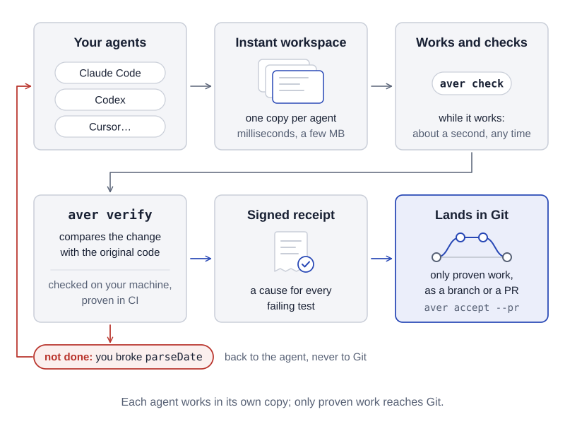
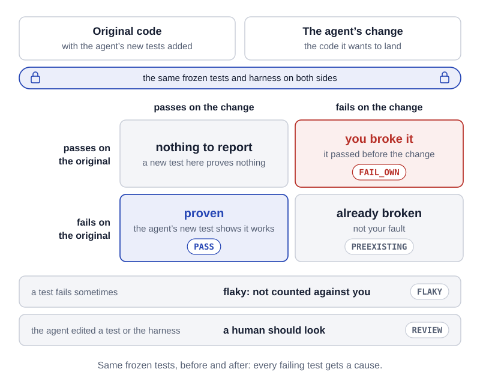
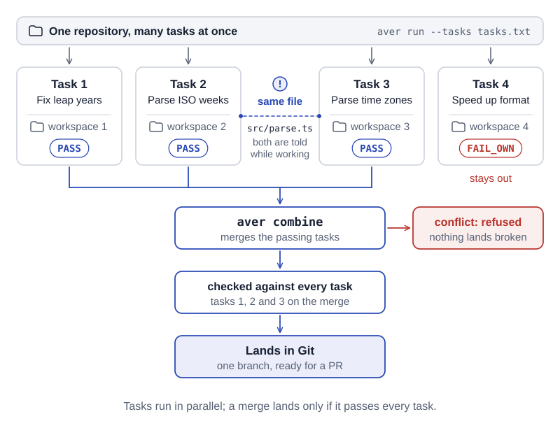
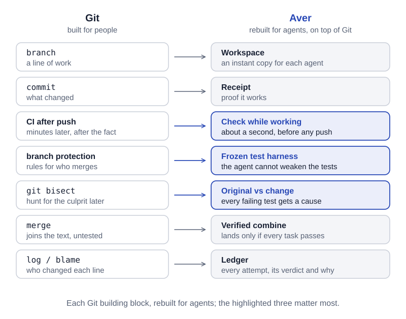

# Diagrams

Explainer diagrams for the launch post, the README and aver.build. Each one is a standalone SVG with real text, in a light and a dark variant (`<name>.svg` and `<name>-dark.svg`). Colours are the site's tokens from `site/style.css`: ink, muted and wash for structure, the link blue as the one accent, and the `NEW` red only where something fails. Text uses the site's fonts, Atkinson Hyperlegible Next and JetBrains Mono, with system fallbacks. An SVG shown through `` cannot load web fonts, so GitHub shows the fallbacks (Helvetica Neue or Arial, and SF Mono or Menlo); the layouts fit both.

Each SVG carries its caption as its last line, plus a `<title>` and a `<desc>` for screen readers. Every diagram is 800 units wide and sized to show at 800 px.

The labels follow `docs/VERDICTS.md`: failing on both sides is the cause `PREEXISTING` (it does not block the verdict; `BLOCKED_NOT_OWN` is for infrastructure and inconclusive checks), and `FLAKY` is a cause, not a verdict.

## how-it-works



Caption: Each agent works in its own copy; only proven work reaches Git.

Alt text: Aver's flow in six steps. Your agents (Claude Code, Codex, Cursor) each get an instant workspace, a copy made in milliseconds that takes a few MB. Each agent works and runs aver check as it goes. aver verify compares its change with the original code, checked on your machine and proven in CI, and writes a signed receipt with a cause for every failing test. Only proven work lands in Git, as a branch or a pull request. One agent's change broke parseDate: it is told it is not done and goes back to work instead of reaching Git.

## the-comparison



Caption: Same frozen tests, before and after: every failing test gets a cause.

Alt text: Aver runs the same frozen tests and harness on two sides: the original code with the agent's new tests added, and the agent's change. A grid shows what each result means. Passes on both: nothing to report, and a new test here proves nothing. Passes on the original but fails on the change: you broke it, FAIL_OWN. Fails on the original but passes on the change: the agent's new test proves the change works, PASS. Fails on both: already broken, not your fault, PREEXISTING. Two more cases: a test that fails only sometimes is flaky and not counted against the agent (FLAKY), and if the agent edited a test or the harness, a human should look (REVIEW).

## many-agents



Caption: Tasks run in parallel; a merge lands only if it passes every task.

Alt text: One repository with four tasks running at once, started with aver run --tasks, each agent in its own workspace. Tasks 2 and 3 both change src/parse.ts, and both agents are told while they work. Tasks 1, 2 and 3 pass; task 4 broke something (FAIL_OWN) and stays out. aver combine merges the passing tasks, checks the merge against tasks 1, 2 and 3, and the result lands in Git as one branch, ready for a pull request. If the changes conflict, the combine is refused and nothing broken lands.

## git-vs-aver



Caption: Each Git building block, rebuilt for agents; the highlighted three matter most.

Alt text: Two columns pairing Git's building blocks, built for people, with Aver's, rebuilt for agents on top of Git. Branch becomes workspace, an instant copy for each agent. Commit, what changed, becomes receipt, proof it works. CI after push becomes check while working, in about a second. Branch protection becomes the frozen test harness, which the agent cannot weaken. git bisect becomes the comparison of the original and the change, which gives every failing test a cause. Merge becomes verified combine, which lands only if every task passes. Log and blame become the ledger: every attempt, its verdict and why. Check while working, the frozen test harness and the comparison are highlighted.

## Using them

On GitHub, a `<picture>` element picks the variant for the reader's colour scheme. Paths are relative to the repository root, as in `README.md`:

```html
<picture>
  <source media="(prefers-color-scheme: dark)" srcset="docs/diagrams/the-comparison-dark.svg">
  
</picture>
```

Swap the name for the other diagrams and use the alt text above. On the site, the same `<picture>` works, since its dark theme also follows `prefers-color-scheme`. In the blog post, the caption is already in the image, so a `<figcaption>` would repeat it.
