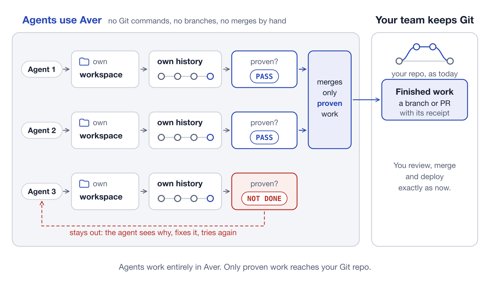

# Your agent says "done". Aver checks.

Draft launch post. Not published. Numbers in double braces, such as `{{NUM:replay-total}}`, are placeholders until the evaluation finishes.

## The problem

The hard part of coding agents is no longer getting them to write code. It is knowing whether the code they hand back does what was asked.

An agent says "done" when it believes it is done. Often it is right. Sometimes it has deleted or weakened the test that was failing. Sometimes it fixed the bug it was given and broke something two files away. Sometimes the failing tests were failing before it started, and it spends an hour on them, or hides behind them.

With five agents on five issues you are reading five diffs, rerunning tests to see which failures were there before, and untangling two agents that edited the same file. You become the bottleneck, because you cannot take an agent's word for it.

Git does not help here. It was built for people who check their own work: a commit records what changed, not whether it works. Branches and worktrees give each agent a checkout, but every worktree needs its own install, and collisions show up only at merge time.

## The pitch

Agents don't use Git anymore. They use Aver. Every agent gets its own workspace, its own history, and merges that only happen when the work is proven. Your team keeps using Git, and Aver hands it finished work.

## How it works



**Workspaces.** Each agent gets its own directory: a copy-on-write clone of one cached checkout, with dependencies linked from a shared store. Creating one on date-fns takes {{NUM:ws-create-aver-p50}}, against {{NUM:ws-create-worktree-p50}} for `git worktree add` before any install. A warm `aver workspace new` takes 87.5 ms (median of 10 runs). Every change the agent makes is snapshotted in its own history, and your working tree is never touched. `aver restore --last-green` rewinds to the last state that broke nothing in about 32 ms.

**Proof.** You say what done means as criteria, for example `-c "last-page: the last page lists the remaining items"`. While it works, the agent runs `aver check`, which runs the tests on its directory and tells it whether its test proves the criterion. When it thinks it is done, it runs `aver verify`. Aver runs the tests on the original code and on the change, test by test. The change counts as done only when:

- each criterion has a test that fails without the change and passes with it;
- nothing that worked before broke;
- no test was weakened: existing tests and the test configuration are judged as the original has them.

The agent reads the report itself. A failure it caused is labelled as its own. A rewritten test expectation goes to a person instead of passing.

**Parallel work.** When two agents change the same files, both are told while they work, with the other's changes. `aver combine` merges the passing work of several tasks and verifies the merge against every task in it; it accepts nothing unless everything together still passes.

**Hand-off.** `aver accept` turns the passing work into a branch whose parent is the commit the agent started from, committed as you, or opens a PR. It arrives with a signed receipt: which tests ran, on which code, and why. You review, merge and deploy as now.

For pull requests from agents that never used Aver, the `aver-verify` GitHub Action posts the same receipt as a comment.

## What it caught

{{NUM:replay-complete}} of {{NUM:replay-total}} real agent pull requests (from Copilot, Codex, Claude Code, Devin, Jules and Cursor, from the public AIDev dataset), replayed through `aver ci`, produced a complete receipt with a cause for every test. Among them, Aver found {{NUM:replay-fail-own}} that broke a test that passed before, {{NUM:replay-changed}} that changed a test expectation, and {{NUM:replay-unproven}} whose claimed fix had no test that failed without it.

In the A/B evaluation, real agents worked the same tasks in a plain `git worktree` and under `aver run`. With Aver, {{NUM:eval-pass-aver}} of {{NUM:eval-tasks}} tasks passed the hidden acceptance tests, against {{NUM:eval-pass-plain}} without it. Agents under Aver used about 19% more tokens.

One small example from our own trials: an agent asked to add `negate(x)` also rewrote `sub` and broke it. Its first `aver verify` said `NOT DONE: FAIL_OWN. 1 of 1 criteria proven, 1 new failure is yours.`, with the failing assertion. It fixed `sub`, verified again, and got `DONE: PASS`.

## What it doesn't do yet

Aver is a prototype. It verifies Node and TypeScript (npm), Python, Rust and Go projects, on macOS, Linux, and Windows through WSL2. Agents are not sandboxed. They run on your machine as you, and checks run in their own copy of the code. A weak test can still prove a criterion, for example one that only loads the new code, so read the criterion tests before you merge. Verifying a change to a large Rust workspace takes minutes, and a workspace of Aver's own Rust repository takes about 7 GiB of disk. There is no hosted service.

## What's next

- The evaluation on hard tasks, with the numbers above filled in from its result files.
- Faster verifies on large Rust workspaces.
- More languages, starting with the test runners people ask for.
- Stronger rules against weak proofs.

## Try it in 2 minutes

```bash
curl -fsSL https://aver.build/install.sh | sh
aver demo
```

`aver demo` takes about 2 seconds, offline. An agent comments out the tests it broke and gets `FAIL_OWN`. `aver restore --last-green` rewinds it, and the real fix gets `PASS`.

Then, in your repository:

```bash
aver init --yes
aver run "Fix the off-by-one in paginate()" -n 1 \
    -c "last-page: the last page lists the remaining items"
```

`aver init` finds your test runner, writes `aver.toml`, and sets up Claude Code and Codex.

Aver is open source under the MIT license, at https://github.com/wonkylamp/aver. Issues and blunt feedback are welcome.
